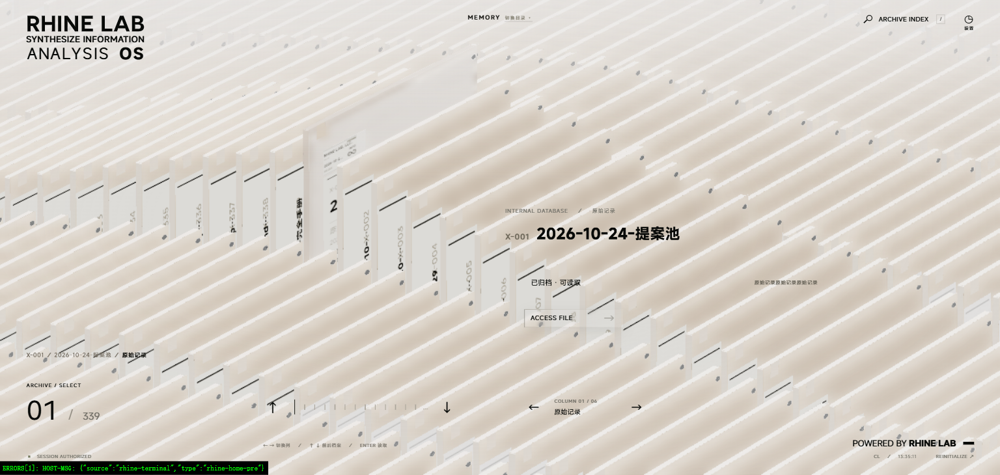

# Rhine Archive Terminal / 莱茵档案终端

把 Obsidian 库里的 Markdown 笔记，显示成一座可以抽取、翻转、解密的三维档案阵列。为桌面端 Obsidian 编写的只读浏览插件。

> **非官方同人作品**：与鹰角网络 / Hypergryph 无关，非商业用途。
> Rhine Lab / 莱茵生命名称、标识与相关视觉属于原权利方；本项目不声称拥有这些权利。
> 详见 [ASSETS.md](ASSETS.md) 与 [THIRD-PARTY-NOTICES.md](THIRD-PARTY-NOTICES.md)。



## 功能

- **档案阵列**：五列分类，卡片以玻璃/黄铜质感排列；点击抽取、悬停查看标题与权限标签。
- **打开即读**：选中档案后进入详情，正文直接在 Obsidian 中打开，保留双链、标签与搜索。
- **解密揭示**：详情页以磨砂盖板开场，沿物理对角线合拢解密线，露出内部结构；减少动态效果时直接显示。
- **360° 查看器**：详情内可旋转、平移、缩放，切换清晰/磨砂，并拆解模型后一键重组。
- **只读**：插件只读取 vault，不写入、不修改任何笔记，也不上传内容。
- **自适应**：按实际视口决定阵列覆盖范围；支持鼠标、触控板与键盘；窄屏切换为单列阅读布局。
- **轻量**：三维场景按需创建，关闭后释放 WebGL 资源；提供减少动态效果与低画质选项。

## 安装

1. 从 [Releases](../../releases) 下载最新的 `rhine-archive-terminal-<version>.zip`。
2. 解压到 `<你的 vault>/.obsidian/plugins/rhine-archive-terminal/`，保证该目录下直接是 `manifest.json`、`main.js`、`styles.css`。
3. 在 Obsidian 中打开 **设置 → 第三方插件**，关闭安全模式，刷新列表并启用 **Rhine Archive Terminal**。
4. 点击左侧 ribbon 的档案图标，或执行命令 **Rhine Archive Terminal: 打开档案终端**。

要求 Obsidian **1.5.0+**、桌面端（`isDesktopOnly: true`），以及支持 WebGL2 的 Chromium 内核。移动端未做支持。

## 构建

```bash
npm install
npm run build          # OSS 构建，Noto Sans SC，输出到 release/rhine-archive-terminal
```

构建产物是可直接放进插件目录的完整文件夹，包含字体、模型、音乐与许可文件，运行时不需要联网。

个人/本地构建使用 MiSans，需要自行提供字体文件（仓库不包含）：

```bash
npm run build:personal -- --out="<vault>/.obsidian/plugins/rhine-archive-terminal"
```

`RHINE_LAB_PUBLIC` 可覆盖个人构建读取 GLB / 字体 / 音频的源目录，默认 `D:/hanakoplace/RhineLabUI/public`。字体栈、标题字重与画布文字会按所选档位自动切换；发布构建会把所有字体引用改到 Noto 优先。

重新生成输入音效（原创合成，不含采样）：

```bash
npm run typing:samples
```

## 目录

```
src/
  app/          终端界面、三维场景、音频、正文字体与样式
  doc-view.css  宿主侧笔记视图样式
  native-skin.css
  plugin-main.ts Obsidian 插件入口
build.mjs       两档构建、静态资源打包、插件清单
media/          原创 GLB、配乐与 Noto 字体
licenses/       Noto OFL 全文
preview/home-i  入口页（随插件打包）
vendor/         hyalite 液态玻璃实现
scripts/        构建期补丁与音效生成
```

## 兼容性与限制

- 仅桌面端；三维场景依赖 WebGL2，极旧显卡或软件渲染会降级或关闭。
- 只读。笔记的新建、编辑、删除仍在 Obsidian 原生界面完成。
- 三维场景首次进入有模型与着色器编译成本；低配机器可在设置中开启低画质或减少动态效果。
- 视觉按 1920×1080 设计，等比适配窗口；窄屏会切换布局，但不是移动端原生体验。

## 许可

- **源代码**：MIT，见 [LICENSE](LICENSE)。
- **Rhine Lab / 莱茵生命名称、标识、界面视觉、模型与配乐**：同人资产，不随 MIT 授权；权利归原方，见 [ASSETS.md](ASSETS.md)。
- **第三方**：three.js、rolling-number、hyalite、Noto Sans SC 等，见 [THIRD-PARTY-NOTICES.md](THIRD-PARTY-NOTICES.md)。

本项目按非商业同人作品发布。若权利方要求，相关名称、标识或资产会应要求移除或替换。
